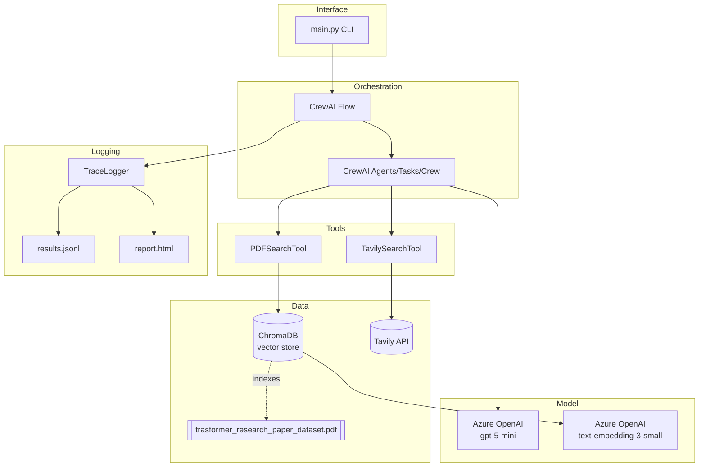
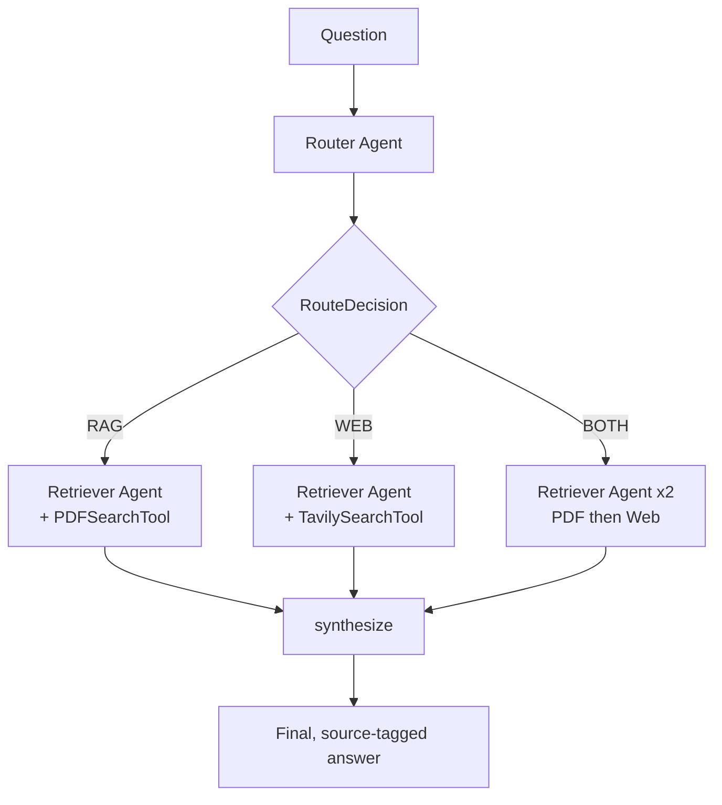

# Agentic RAG: Router-Retriever System

A CrewAI multi-agent system that answers a question by routing it to the right source, retrieving grounded evidence, and returning a cited answer.

## Tech Stack

| Layer | Technology | Role in this project |
|---|---|---|
| Language | Python 3.12 | |
| Agent orchestration | [CrewAI](https://github.com/crewAIInc/crewAI) (`Agent`, `Task`, `Crew`, `Flow`) | Router/Retriever agents, tool-calling loop, `@router`/`@listen` branching |
| Tools | `crewai_tools` (`PDFSearchTool`, `TavilySearchTool`) | PDF and web search, native CrewAI tool-calling |
| Web search API | [Tavily](https://tavily.com) (`tavily-python`) | Live web search results |
| LLM | Azure OpenAI — `gpt-5-mini` deployment | Router reasoning, Retriever answer synthesis |
| Embeddings | Azure OpenAI — `text-embedding-3-small` deployment | Semantic indexing of the PDF for `PDFSearchTool` |
| Vector store | ChromaDB (used internally by `PDFSearchTool`) | Stores and searches PDF chunk embeddings |
| Config / secrets | `python-dotenv` | Loads `.env` (API keys, endpoints, deployment names) |
| Data handling | `pandas` | Trace log as a DataFrame for inspection/export |
| Reporting | Hand-built HTML (`view_results.py`) — stdlib only (`json`, `html`, `pathlib`) | Human-readable report from the JSONL logs |
| Output format | JSONL (`outputs/results.jsonl`, `outputs/trace_log.jsonl`) | Append-safe, per-run structured logging |
| Browser friendly Output | HTML (`outputs/report.html`) | Consolidation of both results and trace_log into one HTML format document suitable for viewing on the web
| CLI | `argparse` (`main.py`) | Run the demo set or a single ad hoc question |

## Architecture stack (visual)



## Architecture (Simplified)



Orchestrated with a CrewAI `Flow` (`flow.py`): `@start` → `@router` →
one of three `@listen("...")` branches → `@listen(or_(...))` to fan back in.
`Flow` was chosen over a flat `Crew` because routing is a genuine three-way
branch point, which `@router` is built for and a plain task list isn't.

## Agent roles

- **Router Agent** (`agents.get_router_agent`) — no tools; reads the question and returns a structured `RouteDecision` (`RAG` / `WEB` / `BOTH` plus reasoning). Pure dispatch, no retrieval.
- **Retriever Agent** (`agents.get_retriever_agent`) — rebuilt per call with exactly one tool attached, so it can only consult the source the Router assigned it. Uses CrewAI's native tool-calling loop: requests the tool, CrewAI runs it, the agent writes the final answer citing what came back.

## Tools

- `tools/pdf_tool.py` — `PDFSearchTool`, indexed on `sample_docs/trasformer_research_paper_dataset.pdf` via Azure OpenAI
  embeddings.
- `tools/web_tool.py` — `TavilySearchTool`, live web search.

## Files

| File | Purpose |
|---|---|
| `config.py` | Loads `.env`, builds the Azure-backed `LLM` and embedding config |
| `models.py` | `RouteDecision`, `RagFlowState` |
| `tools/pdf_tool.py` | PDF search tool |
| `tools/web_tool.py` | Web search tool |
| `agents.py` | Router/Retriever agent + crew helpers, `AgentExecutionError` |
| `flow.py` | The `RagFlow` orchestration |
| `logging_utils.py` | `TraceLogger` — records every agent action per run |
| `results_logger.py` | `save_result` — saves the results in JSONL format |
| `view_results.py` | `build_html` — displays output in HTML format |
| `main.py` | CLI entry point |

## Setup

```bash
pip install crewai, crewai_tools, "crewai[azure-ai-inference]"
pip install python-dotenv, pandas, tavily-python
```
## Inputs
```bash
- sample_docs/trasformer_research_paper_dataset.pdf   # document used for RAG
```

## Running
### Run the application for the demo questions or ask your own question at runtime
### The 3 demo 	questions 
- What is the attention mechanism in transformers?
- What is the latest news on Apple stock?
- How does the original transformer architecture compare to models released this year?

```bash
1. Run application

python main.py                              # runs the 3 demo questions
   OR
python main.py -q "your question here"      # ask your own question

2. Convert results to html
python view_results.py                      # converts results to html in dir outputs

```

Each run prints the routing decision, the final answer, and a trace log
(timestamped agent actions) for that run.

## Outputs
```bash
- outputs/report.html                       # view results of the application in the browser
```

## Error handling

Agent/tool failures are wrapped in `AgentExecutionError` (`agents.py`) rather
than propagating raw exceptions. In `flow.py`:
- A failed **Router** call defaults to `WEB` rather than crashing the run.
- A failed **Retriever** call writes an error message into its context field
  instead of the retrieved text, so `synthesize` still produces an answer
  from whatever source succeeded (useful especially in `BOTH` mode).
- `main.py`'s batch loop catches per-question failures so one bad question
  doesn't stop the rest of the demo set.

## Trade-offs

- **Retriever rebuilt per call, one tool at a time**, rather than one agent
  holding both tools and choosing at runtime. Keeps each run auditable (it's
  structurally impossible to reach for the wrong source) at the cost of the
  routing decision being made once, up front, rather than adaptively.
- **`BOTH` runs retrieval sequentially**, not concurrently. Simple and easy
  to trace; a larger system with more sources would benefit from CrewAI's
  `async_execution` for independent retrievals.
- **PDF and web tools are built once at module level** (`flow.py`), not per
  request, since `PDFSearchTool` re-embeds the whole PDF on construction.


## Why CrewAI fits this specific project
### Design Considerations

* The project has two distinct needs that map onto CrewAI's two building blocks. 
    * **One part is genuinely agentic:** given a question, decide which source to consult, that's a judgment call best made by an LLM reasoning over the question's content, not a rule engine. 
    * **The other part is a fixed, auditable procedure:** route → retrieve → synthesize, always in that order, with a real branch point. CrewAI is one of few frameworks that cleanly separates these two concerns into two different abstractions, Agent/Task/Crew for the reasoning, Flow for the procedure, rather than forcing everything through one mechanism.

* Flow's @router decorator is a near-exact match for the routing requirement. 
    * The spec calls for a Router Agent that "decides the retrieval path," which is inherently a three-way branch (RAG / WEB / BOTH). @router was built specifically to let a step's return value determine which single downstream path executes, which is exactly this branching logic, cheaply and legibly, in code rather than embedded in prompt engineering.

* Tool use is a first-class concept, not something to build from scratch. 
    * The spec requires a PDF search tool and a web search tool that agents can invoke autonomously. CrewAI's native tool-calling loop (an agent decides to call a tool, the framework executes it, the result feeds back into the agent's reasoning) is built in, along with a library of ready-made tools (crewai_tools) including PDFSearchTool and TavilySearchTool used in this project. 

* Role-based agent design keeps responsibilities honest. 
    * Giving each agent a distinct role, goal, and backstory, and giving the Retriever exactly one tool per call, isn't just readability. It structurally prevents the Router from retrieving and the Retriever from reaching for the wrong source, which matters for the traceability and auditability the spec explicitly asks for ("interaction logging for reasoning traceability").

### How it compares to the alternatives
* LangChain (agents/chains alone) covers tools and retrieval well, but its agent abstractions are less oriented around explicit, named roles collaborating as a team
* LangGraph is a legitimate alternative for the branching logic specifically (it's a graph/state-machine model, similar in spirit to Flow), but it's lower-level about agent roles and tool orchestration
* AutoGen leans toward open-ended multi-agent conversation, which suits exploratory or negotiation-style tasks better than this project's need, a fixed, deterministic pipeline with one clean decision point.

### The honest trade-off

* CrewAI's opinionated structure is also a cost
    * Task descriptions and Agent roles are natural-language prompts under the hood, so routing quality depends on how well the Router's task is worded, not a hard-coded rule. That's a deliberate choice appropriate for this project (the routing decision genuinely benefits from language understanding, e.g. recognizing "how does X compare to Y released this year" needs both sources)

